<br/>

<!-- ═══════════════════ INTRO ═══════════════════ -->
<p align="center">
  
</p>

<p align="center">
  Engineering student specialising in <strong>Data Science</strong> with a strong interest in<br/>
  Python · Data Analytics · Machine Learning · Problem Solving
</p>

<p align="center">
  <a href="https://www.linkedin.com/in/harshit-singh-753aaa206">
    
  </a>
  &nbsp;
  <a href="https://www.instagram.com/harshit.exe85">
    
  </a>
  &nbsp;
  <a href="https://github.com/harshitbyte-DS">
    
  </a>
</p>

<br/>

---

<!-- ═══════════════════ ABOUT ═══════════════════ -->
##  &nbsp;About Me

```python
harshit = {
    "name"       : "Harshit Singh",
    "username"   : "harshitbyte-DS",
    "location"   : "India 🇮🇳",
    "roles"      : ["Data Scientist", "ML Engineer", "AI/ML Engineer",
                    "Full-Stack Developer", "Python Developer"],
    "focus"      : ["Machine Learning", "Data Analytics", "DSA", "Web Dev"],
    "languages"  : ["Python", "Java", "JavaScript", "HTML/CSS"],
    "portfolio"  : "https://github.com/harshitbyte-DS/harshit-singh-portfolio",
    "goal"       : "Build data-driven products that make a real impact 🎯",
    "open_to"    : "Internships · Collaborations · Open Source"
}
```

<br/>

---

<!-- ═══════════════════ SKILLS ═══════════════════ -->
##  &nbsp;Skills & Technologies

<table>
  <tr>
    <td valign="top" width="33%">
      <strong>🤖 AI / ML / Data</strong><br/><br/>
      
      
      
      
      
      
    </td>
    <td valign="top" width="33%">
      <strong>🌐 Web / Full-Stack</strong><br/><br/>
      
      
      
      
      
    </td>
    <td valign="top" width="33%">
      <strong>⚙️ Dev Tools</strong><br/><br/>
      
      
      
      
      
    </td>
  </tr>
</table>

<br/>

---

<!-- ═══════════════════ PROJECTS ═══════════════════ -->
##  &nbsp;Featured Projects

<table>
  <tr>
    <td width="50%" valign="top">
      <h3>🌐 Portfolio Website</h3>
      <p>Personal developer portfolio showcasing skills, projects, and experience in Computer Science and Data Science. Built with JavaScript for a dynamic, responsive experience.</p>
      <p>
        
        
        
      </p>
      <a href="https://github.com/harshitbyte-DS/harshit-singh-portfolio">
        
      </a>
    </td>
    <td width="50%" valign="top">
      <h3>⚔️ Chakravyuh</h3>
      <p>An interactive web project built with HTML. A creative and engaging application demonstrating front-end development skills and problem-solving through the web.</p>
      <p>
        
        
      </p>
      <a href="https://github.com/harshitbyte-DS/Charkravyuh">
        
      </a>
    </td>
  </tr>
  <tr>
    <td width="50%" valign="top">
      <h3>☕ DSA with Java</h3>
      <p>Comprehensive Data Structures and Algorithms practice repository in Java. Covers arrays, linked lists, trees, graphs, sorting, searching, and dynamic programming.</p>
      <p>
        
        
      </p>
      <a href="https://github.com/harshitbyte-DS/DSA-WITH-JAVA">
        
      </a>
    </td>
    <td width="50%" valign="top">
      <h3>🔢 LeetCode Classwork</h3>
      <p>Collection of LeetCode problem solutions and class-based algorithm practice in Java. Tracks progress on competitive programming and interview preparation.</p>
      <p>
        
        
      </p>
      <a href="https://github.com/harshitbyte-DS/LEETCODE-CLASS-WORK">
        
      </a>
    </td>
  </tr>
</table>

<br/>

---

<!-- ═══════════════════ GITHUB STATS ═══════════════════ -->
##  &nbsp;GitHub Stats

<p align="center">
  
  &nbsp;
  
</p>

<p align="center">
  
</p>

<p align="center">
  
</p>

<br/>

---

<!-- ═══════════════════ CONNECT ═══════════════════ -->
##  &nbsp;Let's Connect

<p align="center">
  <a href="https://www.linkedin.com/in/harshit-singh-753aaa206" target="_blank">
    
  </a>
  &nbsp;
  <a href="https://www.instagram.com/harshit.exe85" target="_blank">
    
  </a>
  &nbsp;
  <a href="https://github.com/harshitbyte-DS?tab=repositories" target="_blank">
    
  </a>
</p>

<p align="center">
  
</p>

<br/>

<p align="center">
  
</p>

<!-- Quote -->
<p align="center">
  <em style="color:#C77B9B">"Data is the new oil — but only if you know how to refine it."</em>
</p>
